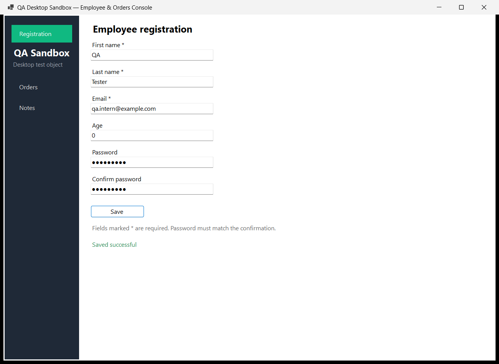

# Desktop QA Sandbox — ручное тестирование десктопного приложения


Учебный проект портфолио: **ручное** функциональное и негативное тестирование небольшого WinForms-приложения
с тремя разделами — регистрация сотрудника, заказы и заметки. В приложение намеренно заложены **14 дефектов**;
каждый из них воспроизведён вручную и подтверждён скриншотом или подробным протоколом.

> **Об объекте:** это учебный стенд, а не реальный продукт. Дефекты созданы специально, чтобы показать полный
> цикл работы тестировщика: тест-план → тест-кейсы → ручной прогон → баг-репорт → отчёт.

---

## Скриншоты дефектов

| Регистрация | Недопустимый e-mail принят |
|-------------|----------------------------|
|  |  |

| Сырой stack trace | Возраст 0 принят |
|-------------------|------------------|
|  |  |

| Удаление: итог не пересчитан | Сортировка суммы как текста |
|------------------------------|-----------------------------|
|  |  |

| Заметка обрезана до 255 | Повторная скидка |
|-------------------------|------------------|
|  |  |

Остальные скриншоты — в каталоге [`evidence/`](evidence).

---

## Что проверялось вручную

| Раздел | Проверки |
|--------|----------|
| **Registration** | Обязательные поля, формат e-mail, возраст (0, отрицательный, нечисловой), пароль и подтверждение, текст сообщения об успехе |
| **Orders** | Итог по заказам, однократная и повторная скидка, удаление строки, сортировка суммы, поиск по клиенту, сброс |
| **Notes** | Сохранение заметки в файл, лимит 255 символов, очистка, счётчик символов |
| **Окно** | Навигация, минимальный размер, закрытие с несохранёнными данными |

Всего: **38 ручных тест-кейсов**, из них 17 PASS, 16 FAIL, 5 не выполнялись (честно отмечены как N/R).

---

## Каталог дефектов

| ID | Дефект | Severity |
|----|--------|----------|
| [D-01](docs/03-defect-catalog.md#d-01) | E-mail без домена верхнего уровня принимается (`user@domain`) | Major |
| [D-02](docs/03-defect-catalog.md#d-02) | Возраст 0 и отрицательный принимаются | Major |
| [D-03](docs/03-defect-catalog.md#d-03) | Скидка применяется повторно при каждом клике | Major |
| [D-04](docs/03-defect-catalog.md#d-04) | Удаление строки без подтверждения | Major |
| [D-05](docs/03-defect-catalog.md#d-05) | Итог не пересчитывается после удаления и фильтрации | Critical |
| [D-06](docs/03-defect-catalog.md#d-06) | Суммы сортируются как текст (`0.99, 100.00, 12.00`) | Minor |
| [D-07](docs/03-defect-catalog.md#d-07) | Поиск регистрозависимый (`alpha` ≠ `Alpha Corp`) | Minor |
| [D-08](docs/03-defect-catalog.md#d-08) | Заметка обрезается до 255 символов без предупреждения | Major |
| [D-09](docs/03-defect-catalog.md#d-09) | Несовпадение паролей: сообщение «Error» без указания полей | Minor |
| [D-10](docs/03-defect-catalog.md#d-10) | Опечатка «Saved successful» | Trivial |
| [D-11](docs/03-defect-catalog.md#d-11) | Нечисловой возраст: в UI сырой stack trace | Major |
| [D-12](docs/03-defect-catalog.md#d-12) | Clear очищает заметку без подтверждения и undo | Minor |
| [D-13](docs/03-defect-catalog.md#d-13) | Слабый пароль принимается (правило не подключено) | Major |
| [D-14](docs/03-defect-catalog.md#d-14) | Закрытие с несохранённой заметкой без предупреждения | Major |

Полные описания с шагами воспроизведения: [`docs/03-defect-catalog.md`](docs/03-defect-catalog.md).

---

## Как запустить и протестировать вручную

Требования: Windows 10/11, .NET SDK 11 (приложение собирается без прав администратора).

```powershell
dotnet build src/DesktopSandbox/DesktopSandbox.csproj -c Release
src\DesktopSandbox\bin\Release\net11.0-windows\DesktopSandbox.exe
```

Затем откройте [`docs/02-test-cases.md`](docs/02-test-cases.md) и выполняйте шаги вручную.
Для фиксации результата используйте штатный инструмент снимка экрана Windows (Win+Shift+S)
или PrintScreen — никаких дополнительных утилит в репозитории нет.

---

## Структура репозитория

```
desktop-qa-sandbox/
├─ src/DesktopSandbox/          # тестируемое WinForms-приложение
│  ├─ Program.cs
│  ├─ MainForm.cs
│  └─ Rules.cs
├─ docs/
│  ├─ 01-test-plan.md
│  ├─ 02-test-cases.md          # 38 ручных кейсов
│  ├─ 03-defect-catalog.md      # D-01…D-14
│  ├─ 04-environment.md
│  └─ 05-test-summary.md
└─ evidence/                    # скриншоты, сделанные во время ручного прогона
```

---

## Что демонстрирует проект

- Умение структурировать **ручное** тестирование десктопного приложения: план, кейсы, баг-репорты, отчёт.
- Понимание разницы между «правило есть» и «правило подключено» (D-13: `Rules.IsValidPassword` существует,
  но не вызывается).
- Навык локализовать дефект до метода и строки кода — баг-репорты содержат причину и рекомендацию.
- Аккуратная доказательная база: скриншоты для каждого дефекта и честная отметка непроверенных кейсов.

---

## Лицензия

[MIT](LICENSE). Приложение учебное, любые совпадения с реальными системами случайны.
