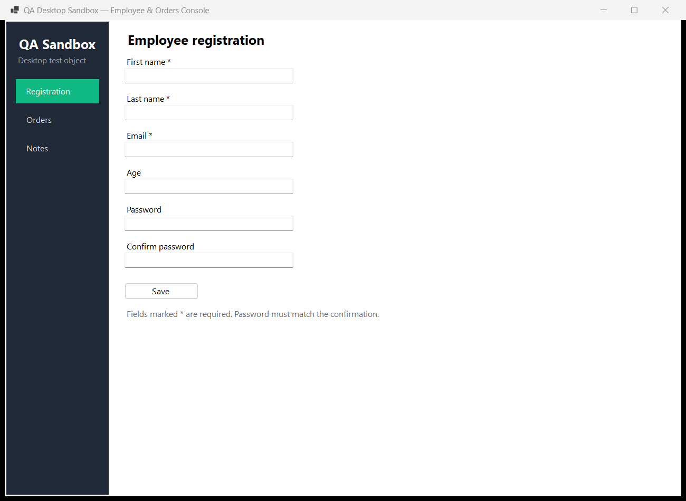
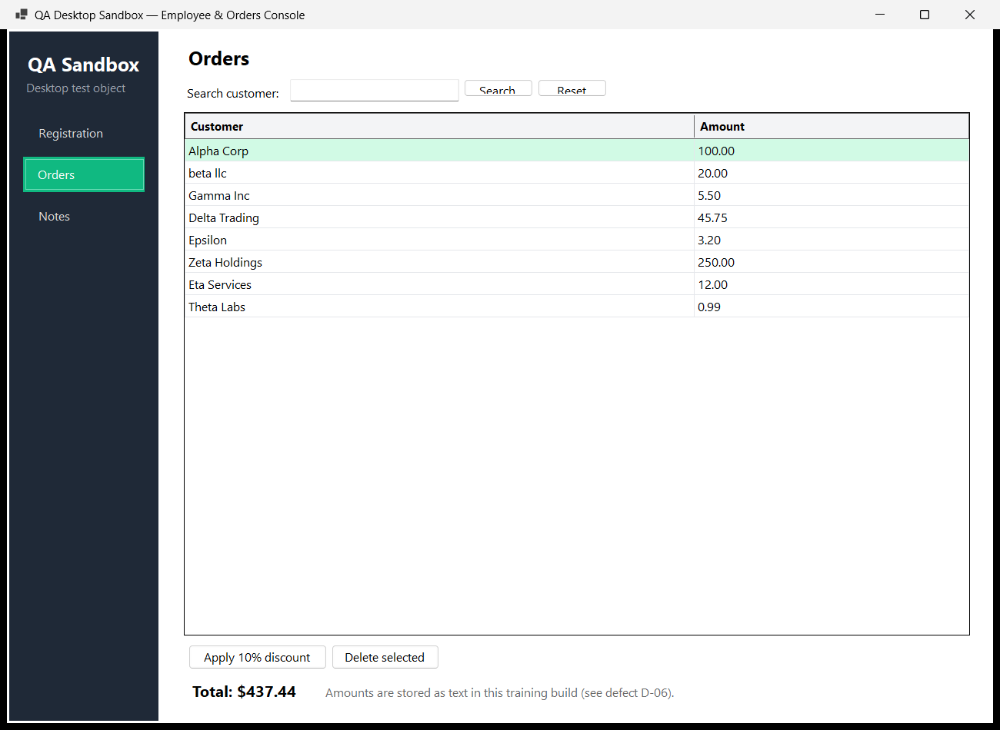
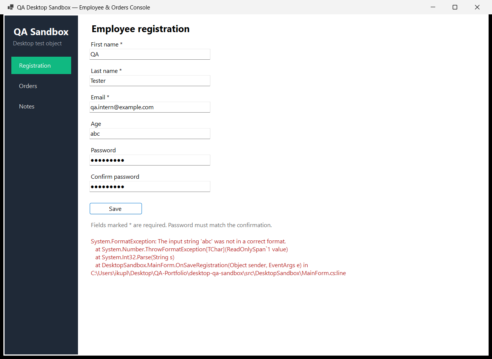
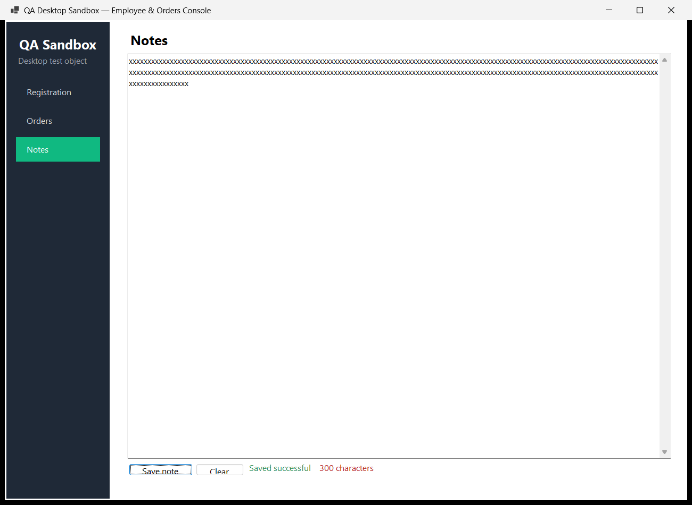

# Desktop QA Sandbox — тестирование десктопного приложения


Учебный стенд для практики тестирования **десктопного приложения**: WinForms-приложение с тремя разделами
(регистрация сотрудника, заказы, заметки), в которое **намеренно заложены 14 дефектов**. К приложению прилагаются
ручные тест-кейсы, каталог дефектов и автоматический прогон на **UI Automation**, который воспроизводит каждый
дефект и отличает его от корректного поведения.

> **Честно о природе объекта:** это не «найденные в дикой природе» баги, а специально созданный тренажёр.
> Ценность проекта — не в факте наличия дефектов, а в полном цикле: тест-план → кейсы → воспроизведение →
> оформление → автоматизация → отчёт. Все дефекты реально воспроизводятся в собранном приложении.

---

## Скриншоты

| Регистрация | Заказы |
|-------------|--------|
|  |  |

| Удаление строки: итог не пересчитан | Сортировка суммы как текста |
|-------------------------------------|-----------------------------|
|  |  |

| Сырой stack trace вместо валидации | Заметка молча обрезана до 255 |
|------------------------------------|-------------------------------|
|  |  |

---

## Что внутри

| Раздел | Что проверяет |
|--------|---------------|
| **Registration** | Обязательные поля, e-mail, возраст, пароль и подтверждение, сообщение об успехе |
| **Orders** | Итог по заказам, скидка, удаление строки, сортировка суммы, поиск по клиенту |
| **Notes** | Сохранение заметки в файл, лимит 255 символов, очистка, счётчик символов |
| **Окно** | Закрытие с несохранёнными данными, минимальный размер, навигация |

---

## Каталог дефектов

| ID | Дефект | Severity | Где воспроизводится |
|----|--------|----------|---------------------|
| [D-01](docs/03-defect-catalog.md#d-01) | E-mail без домена верхнего уровня принимается (`user@domain`) | Major | Registration |
| [D-02](docs/03-defect-catalog.md#d-02) | Возраст 0 и отрицательный принимаются | Major | Registration |
| [D-03](docs/03-defect-catalog.md#d-03) | Скидка применяется повторно при каждом клике | Major | Orders |
| [D-04](docs/03-defect-catalog.md#d-04) | Удаление строки без подтверждения | Major | Orders |
| [D-05](docs/03-defect-catalog.md#d-05) | Итог не пересчитывается после удаления и фильтрации | Critical | Orders |
| [D-06](docs/03-defect-catalog.md#d-06) | Суммы сортируются как текст (`0.99, 100.00, 12.00`) | Minor | Orders |
| [D-07](docs/03-defect-catalog.md#d-07) | Поиск регистрозависимый (`alpha` ≠ `Alpha Corp`) | Minor | Orders |
| [D-08](docs/03-defect-catalog.md#d-08) | Заметка обрезается до 255 символов без предупреждения | Major | Notes |
| [D-09](docs/03-defect-catalog.md#d-09) | Несовпадение паролей: сообщение «Error» без указания полей | Minor | Registration |
| [D-10](docs/03-defect-catalog.md#d-10) | Опечатка «Saved successful» | Trivial | Registration, Notes |
| [D-11](docs/03-defect-catalog.md#d-11) | Нечисловой возраст: в UI сырой stack trace | Major | Registration |
| [D-12](docs/03-defect-catalog.md#d-12) | Clear очищает заметку без подтверждения и undo | Minor | Notes |
| [D-13](docs/03-defect-catalog.md#d-13) | Слабый пароль принимается (правило не подключено) | Major | Registration |
| [D-14](docs/03-defect-catalog.md#d-14) | Закрытие с несохранённой заметкой без предупреждения | Major | Окно |

Полные описания: [`docs/03-defect-catalog.md`](docs/03-defect-catalog.md).

---

## Автоматизация

Проект `automation/DesktopSandbox.UiChecks` использует **Microsoft UI Automation** (без Selenium/Appium):

- запускает приложение, находит элементы по `AutomationId`;
- вводит данные через `ValuePattern`, нажимает кнопки через `InvokePattern`;
- читает таблицу и итог, проверяет сортировку и границы;
- печатает Markdown-таблицу «кейс → ожидание → факт → вердикт»;
- имеет режим `--logic` без UI — для CI.

**Результат последнего прогона** (Windows 11, .NET 11):

| Режим | PASS | Дефектов воспроизведено | FAIL |
|-------|------|--------------------------|------|
| UI (`DesktopSandbox.UiChecks.exe`) | 3 | 15 (14 уникальных ID) | 0 |
| Logic (`--logic`) | 2 | 3 | 0 |

Полные логи: [`evidence/automation-run.txt`](evidence/automation-run.txt),
[`evidence/logic-checks.txt`](evidence/logic-checks.txt).

```powershell
# сборка
dotnet build src/DesktopSandbox/DesktopSandbox.csproj -c Release
dotnet build automation/DesktopSandbox.UiChecks/DesktopSandbox.UiChecks.csproj -c Release

# UI-прогон (нужен интерактивный рабочий стол)
automation\DesktopSandbox.UiChecks\bin\Release\net11.0-windows\DesktopSandbox.UiChecks.exe `
  src\DesktopSandbox\bin\Release\net11.0-windows\DesktopSandbox.exe

# логический прогон для CI
dotnet run --project automation/DesktopSandbox.UiChecks -c Release -- --logic
```

Подробнее: [`docs/05-automation.md`](docs/05-automation.md).

---

## Сборка и запуск

Требования: Windows 10/11, .NET SDK 11 (проект также собирается на .NET 8 при смене TFM).

```powershell
dotnet build src/DesktopSandbox/DesktopSandbox.csproj -c Release
src\DesktopSandbox\bin\Release\net11.0-windows\DesktopSandbox.exe
```

Скриншоты делаются скриптом `automation/Capture-Evidence.ps1` (Win32 `PrintWindow`, работает без фокуса окна).

---

## Структура репозитория

```
desktop-qa-sandbox/
├─ src/DesktopSandbox/          # тестируемое WinForms-приложение
│  ├─ Program.cs
│  ├─ MainForm.cs               # UI + заложенные дефекты
│  └─ Rules.cs                  # правила валидации, скидка, обрезка
├─ automation/
│  ├─ DesktopSandbox.UiChecks/  # UI Automation прогон + --logic
│  └─ Capture-Evidence.ps1      # скриншоты через PrintWindow
├─ docs/
│  ├─ 01-test-plan.md
│  ├─ 02-test-cases.md          # 38 кейсов
│  ├─ 03-defect-catalog.md      # D-01…D-14
│  ├─ 04-environment.md
│  ├─ 05-automation.md
│  └─ 06-test-summary.md
└─ evidence/                    # скриншоты и логи прогонов
```

---

## Что демонстрирует проект

- Умение тестировать **десктоп**, а не только веб: UI Automation, работа с таблицами, диалогами, файлами.
- Понимание разницы между «правило есть» и «правило подключено» (D-13: `Rules.IsValidPassword` существует,
  но не вызывается).
- Навык писать воспроизводимые баг-репорты с точной локализацией (файл/строка/метод).
- Автоматизацию проверок, которая **ожидает дефект** и падает, если поведение внезапно стало корректным, —
  это защищает от «тихого» изменения стенда.
- Аккуратное оформление: README, docs, лицензия, .gitignore, CI.

---

## Лицензия

[MIT](LICENSE). Приложение учебное, любые совпадения с реальными системами случайны.
